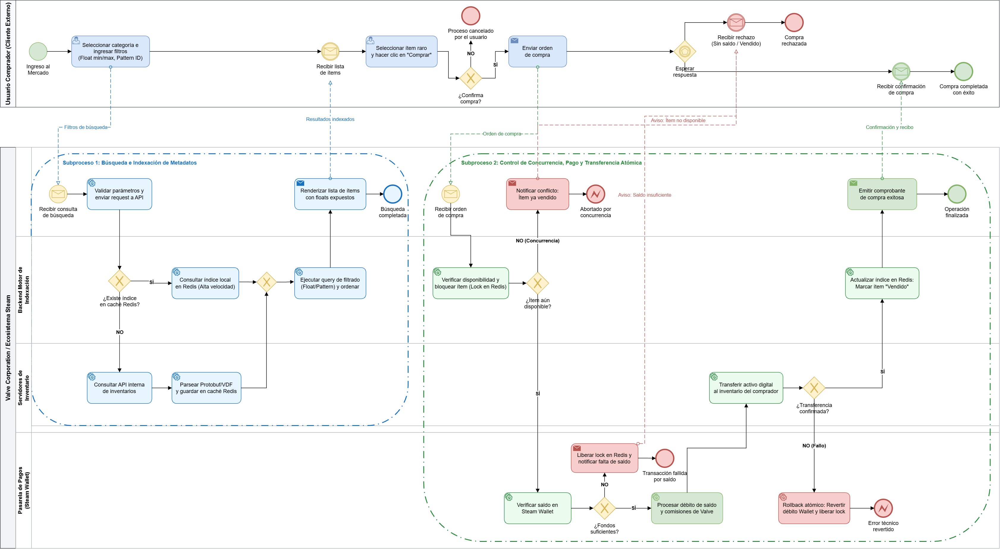

# 4. Modelado de Procesos (BPMN 2.0) y Casos de Uso

## Arquitectura del Proceso (`bpmn-busqueda-compra-steam.png`)

El diagrama BPMN 2.0 modela de extremo a extremo la búsqueda avanzada por metadatos (*Float Value*, *Pattern ID*) y el flujo transaccional de compra en el Mercado de la Comunidad de Steam:
* **Separación de Pools y Mensajes:** Se diferencian `Usuario Comprador (Cliente Externo)` y `Valve Corporation / Ecosistema Steam`, vinculados exclusivamente mediante **Flujos de Mensaje** discontinuos.
* **Subproceso 1 (Búsqueda e Indexación):** Consulta rápida en caché **Redis** y actualización en segundo plano mediante parseo de estructuras **Protobuf/VDF** desde los Servidores de Inventario.
* **Subproceso 2 (Compra, Concurrencia y Consistencia):** Incorpora un bloqueo atómico (*Lock* en Redis) previo al débito en *Steam Wallet* y una rutina de **Rollback atómico** ante fallos de transferencia.

## Casos de Uso Principales
* **CU-01 — Filtrar y Buscar Ítems Raros por Metadatos:** Permite consultar activos por *Float* y *Pattern ID*, contemplando flujos alternativos por fallo de caché (*Cache Miss*) y búsqueda sin resultados.
* **CU-02 — Comprar Ítem con Metadatos Especificados:** Gestiona la reserva atómica del activo, validación de saldo en *Steam Wallet*, transferencia de propiedad y reversión (*Rollback*) ante conflictos de concurrencia o errores de red.
